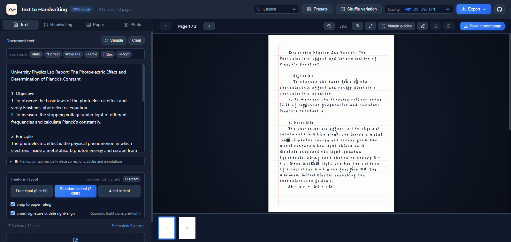

# Text2Handwriting - Turn Text into Realistic Handwriting, Fully Local

[](LICENSE) [](https://github.com/rockbenben/365opensource)

> Turn plain text into realistic handwriting — fully local in your browser, nothing ever uploaded.

[▶ Try it online](https://shouxie.newzone.top) · [⬇ Source](https://github.com/rockbenben/text2handwriting) · [中文](README.md)



## Requirements

| Item | Details |
| --- | --- |
| Runs in | Any modern browser, purely client-side; Chrome / Edge 103+ can enumerate all locally installed fonts, Safari / Firefox fall back to built-in font detection |
| Import | Paste text, or upload `.txt` / `.md` (UTF-8 / GBK auto-detected), `.docx` |
| Export | PNG / JPG per page, ZIP of all pages, multi-page PDF, browser printing — three quality tiers up to ~435 DPI |
| Interface | Simplified Chinese, Traditional Chinese, English |
| Offline | Installable as a PWA; settings persist locally |

## What it does

- **Realistic handwriting**: seed-controlled pseudo-random perturbation — glyph size, rotation, baseline jitter, ink depth and bleed, whole-line drift. Every render is different; keep the seed to reproduce one
- **CJK typesetting**: line-start / line-end punctuation rules, first-line indent, automatic pagination, right-aligned signature
- **6 paper styles + custom backgrounds**: ruled notebook, composition grid, A4, four-line English practice sheets, kraft letter paper, dot-grid journal — or upload a photo of your own blank worksheet and it adapts automatically
- **Any font**: 4 open-source handwriting fonts bundled (works offline); load web fonts, system fonts, or import `.ttf` / `.otf` files — use [Calligraphr](https://www.calligraphr.com/) to turn your own handwriting into a font, and the output is 100% your hand
- **Realistic corrections**: 13 strikethrough styles (diagonal, wavy, scribble…) appearing with realistic probability; mark wrong characters, write corrections above the line, circle or box highlights — plus a drawing layer for arrows, sketches and formulas right on the paper
- **Writing personas**: 4 one-click presets (neat student / casual notes / rushed scrawl / formal copy), with pen types for gel / fountain / pencil / ballpoint

### Markup syntax: manual corrections

Annotate text directly to control where corrections appear (markup overrides random probability):

| Syntax | Effect |
| --- | --- |
| `~~wrong~~` or `[del]wrong[/del]` | Strike through |
| `[del:fix]typo[/del]` | Strike through and write the correction above the line |
| `[u]highlight[/u]` | Wavy underline |
| `[circle]highlight[/circle]` | Circle it |
| `[box]highlight[/box]` | Box it |

Tags must be properly paired; mismatched ones like `[circle]x[/框]` are rendered as plain text. The same table is available in the app under the "Markup syntax" hint below the text box.

---

## Known limitations

- Line breaking uses estimated glyph widths, not `ctx.measureText`. With fonts whose widths deviate far from the estimate (e.g. Kaiti variants, imported .ttf files), line endings may slightly overshoot or undershoot.
- Browser printing outputs the current page only; use PDF export for all pages.
- Safari below 16 lacks `ctx.filter`, so brightness / contrast adjustments for paper backgrounds have no effect there.
- The drawing layer is bound to page numbers and not persisted; re-pagination after editing may misalign existing drawings.
- Imported font files live in session memory only and must be re-imported after a page refresh.

## Local development

Requires Node.js **22.12+ / 24+ / 26+** (Vitest 5's supported range; CI builds on Node 26).

```bash
npm install
npm run dev        # dev server at http://localhost:5173/
npm run test       # unit tests (vitest)
npm run lint       # oxlint
npm run build      # production build (tsc + vite)
```

The build output uses relative paths (`base: './'`), so `dist/` deploys directly to GitHub Pages, intranets, or any static server. Deployment details, chunk-splitting strategy, project structure, and the i18n guide live in [docs/development.md](docs/development.md).

## License

- **Code**: MIT, see `LICENSE`
- **Fonts**: the 4 fonts in `public/fonts/` are under the SIL Open Font License (OFL), see `LICENSE-FONTS.md`

This is an independent implementation with no affiliation to AutoHanding or its operator; only the design approach was referenced.

## About the 365 Open Source Plan

Project **#039** of the [365 Open Source Plan](https://github.com/rockbenben/365opensource) — one person + AI, 300+ open-source projects in a year.

[Submit your idea →](https://365.aishort.top/) · [Discord](https://discord.gg/PZTQfJ4GjX) · [Telegram](https://t.me/aishort_top)
