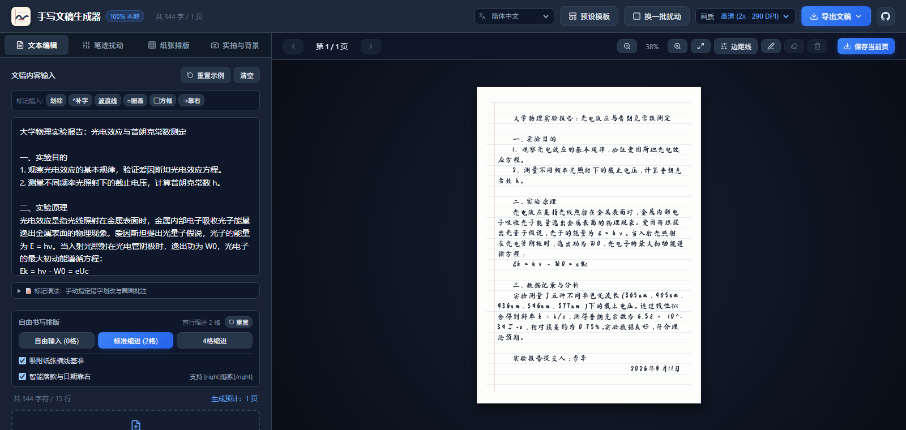

# 手写文稿生成器 - 文字转手写，纯本地渲染

[](LICENSE) [](https://github.com/rockbenben/365opensource)

> 把普通文本排成"像人写的"手写文稿——作业、检讨、笔记、手稿打印，全程在浏览器本地渲染，不上传任何服务器。

[▶ 在线试用](https://shouxie.newzone.top) · [⬇ 源码](https://github.com/rockbenben/text2handwriting) · [English](README.en.md)



## 支持范围

| 项目 | 说明 |
| --- | --- |
| 运行环境 | 现代浏览器，纯前端运行；Chrome / Edge 103+ 可枚举本机全部字体，Safari / Firefox 自动改用内置字体探测 |
| 导入 | 粘贴文本，或上传 `.txt` / `.md`（自动识别 UTF-8 / GBK）、`.docx` |
| 导出 | 当前页 PNG / JPG、全部页面 ZIP、多页 PDF、浏览器打印，三档画质最高约 435 DPI |
| 界面语言 | 简体中文、繁體中文、English |
| 离线 | PWA 安装到桌面 / 手机后断网可用；设置自动保存在本地 |

## 它能做什么

- **手写真实感**：种子控制的伪随机扰动——字号浮动、旋转、基线抖动、墨迹深浅洇墨、整行漂移，每版输出都不同；记下种子可复现同一次输出
- **中文排版**：避头尾法则、首行缩进、长文档自动分页、落款右对齐
- **6 种纸张 + 自定义底图**：横线本、作文方格、A4、英语四线三格、牛皮信笺、点阵手帐；也可上传手机拍的空白作业纸 / 试卷，自动按照片比例适配
- **字体随便换**：自带 4 款开源手写字体（离线可用），可加载在线字体、系统字体，或导入 `.ttf` / `.otf` 字体文件——用 [Calligraphr](https://www.calligraphr.com/) 把自己的笔迹做成字体，出来的字 100% 是你写的
- **拟真修改痕迹**：13 种划改样式（斜线、波浪、涂抹等）按真实概率随机出现，可标错字、在线上方写改正字、圈出重点；预览工具栏还能直接在纸上手绘箭头、简图、公式
- **书写人格**：工整学霸 / 随性笔记 / 潦草赶工 / 郑重抄写 4 种一键预设，笔型可选中性笔 / 钢笔 / 铅笔 / 圆珠笔

### 标记语法：手动指定修改痕迹

在文本里直接标注哪些字要划掉、哪些要圈出来（标记优先于随机概率生效）：

| 语法 | 效果 |
| --- | --- |
| `~~错字~~` 或 `[del]错字[/del]` | 划掉这段字 |
| `[del:纠正]笔误[/del]` | 划掉并在线上方写出正确字 |
| `[u]重点[/u]` | 加波浪下划线 |
| `[circle]重点[/circle]` | 圈出（中文别名 `[圈]…[/圈]`） |
| `[box]重点[/box]` | 框出（中文别名 `[框]…[/框]`） |

标签必须成对同名，`[circle]x[/框]` 这类错配会被当作普通文字原样输出；界面里点文本框下方的「标记语法」提示也能看到这张表。

---

## 已知限制

- 排版使用估算字宽，未调用 `ctx.measureText`。使用系统与推荐字宽偏差较大的字体（如华文行楷、用户导入的 .ttf）时，行尾可能略微超出或短于预期位置。
- 浏览器打印只打印当前页；全部页请用 PDF 导出。
- Safari 16 以下不支持 `ctx.filter`，底图的亮度 / 对比度调节在该浏览器上无效。
- 手绘层按页码绑定且不持久化；编辑正文导致分页变化后，原有手绘可能错位。
- 导入的字体文件只在本会话内存中有效，刷新页面后需要重新导入。

## 本地开发

需要 Node.js **>= 22.12**（Vitest 5 的下限；CI 用 Node 24 构建）。

```bash
npm install
npm run dev        # 开发服务器 http://localhost:5173/
npm run test       # 单元测试 (vitest)
npm run lint       # oxlint
npm run build      # 生产构建 (tsc + vite)
```

构建产物走相对路径（`base: './'`），`dist/` 可直接部署到 GitHub Pages、企业内网或任意静态服务器。部署细节、分包策略、项目结构与新增语言指南见 [docs/development.md](docs/development.md)。

## 许可

- **代码**：MIT，见 `LICENSE`
- **字体**：`public/fonts/` 下 4 款字体为 SIL Open Font License (OFL) 许可，字体授权见 `LICENSE-FONTS.md`

本项目为独立实现，与凹凸工坊 (AutoHanding) 及其运营方无任何关联，仅在设计思路上有所参考。

## 关于 365 开源计划

[365 开源计划](https://github.com/rockbenben/365opensource) 的第 **#039** 个项目——一个人 + AI，一年 300+ 个开源项目。

[提交你的需求 →](https://365.aishort.top/) · [Discord](https://discord.gg/PZTQfJ4GjX) · [Telegram](https://t.me/aishort_top)
