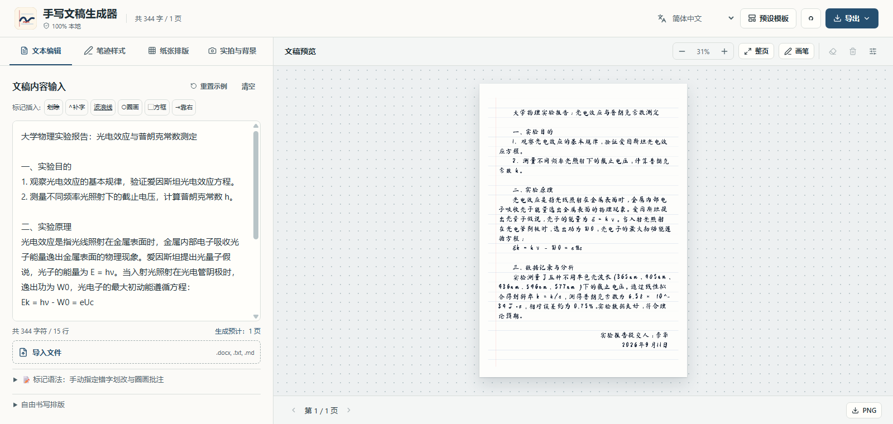

# 手写文稿生成器 (Text2Handwriting)

> 把普通文本排成逼真手写文稿，作业检讨笔记一键生成，全程本地不上传。

**简体中文** · [English](README.en.md) · [繁體中文](docs/i18n/README.zh-Hant.md) · [日本語](docs/i18n/README.ja.md) · [한국어](docs/i18n/README.ko.md) · [Español](docs/i18n/README.es.md) · [Français](docs/i18n/README.fr.md) · [Deutsch](docs/i18n/README.de.md) · [Português](docs/i18n/README.pt.md) · [Русский](docs/i18n/README.ru.md) · [Italiano](docs/i18n/README.it.md) · [العربية](docs/i18n/README.ar.md) · [हिन्दी](docs/i18n/README.hi.md) · [বাংলা](docs/i18n/README.bn.md) · [ไทย](docs/i18n/README.th.md) · [Türkçe](docs/i18n/README.tr.md) · [Tiếng Việt](docs/i18n/README.vi.md) · [Bahasa Indonesia](docs/i18n/README.id.md)

[](LICENSE) [](https://github.com/rockbenben/365opensource)

[▶ 在线试用](https://shouxie.newzone.top)



适合需要补交纸质作业、誊抄读书笔记、准备手写检讨或打印手写信件的场景。不同于机械替换字体的普通生成器，它基于随机种子实时扰动每个字的字号、倾斜与基线，模拟真实墨迹深浅与涂改笔误，无需注册账号或上传云端，在浏览器本地即可得到自然逼真的手写文稿。

## 支持范围

| 维度 | 说明 |
|---|---|
| 运行环境 | 现代桌面与移动浏览器纯前端本地运行；窄屏自动切换为「编辑 / 预览」单栏工作区（Chrome / Edge 103+ 支持枚举本机全部字体，Safari / Firefox 自动切换内置探测） |
| 导入格式 | 直接粘贴文本，或上传 `.txt` / `.md`（严格 UTF-8 校验与 GB18030 兜底）、`.docx`（客户端免上传解析） |
| 纸张底纹 | 6 种常用纸张（横线本、作文方格、A4 白纸、英语四线三格、牛皮信笺、点阵手帐），支持上传手机拍纸照片自适应缩入 |
| 笔型质感 | 中性笔、钢笔、铅笔、圆珠笔 4 种物理笔型；支持漫反射环境光、折痕明暗线、四角镜头暗角与岁月泛黄质感 |
| 导出选项 | 当前页 PNG / JPG、全部页面 ZIP 打包、多页 PDF、隐藏 iframe 真实毫米无损打印（三档画质最高约 435 DPI） |
| 语言排版 | 内置 18 种语言完整翻译（简体中文、繁體中文、English、日本語、한국어、Deutsch、Español、Français、Italiano、Português、Русский、العربية、हिन्दी、বাংলা、Bahasa Indonesia、ไทย、Tiếng Việt、Türkçe）；支持中文避头尾法则、英文断词保护、阿拉伯语双向排版 (BiDi RTL) 与原生连笔整形 |
| 离线存储 | PWA 离线外壳支持安装到桌面与手机；Web Locks 跨标签页并发互斥保护，自动 250ms 防抖保存与离开前防误关确认 |

## 能做什么

- **手写真实感**：种子控制的伪随机扰动——字号浮动、字距微调、基线抖动、整行漂移、笔迹洇墨深浅与书写疲劳效应，每版输出都不同；记下种子可 100% 精确复现同一次排版。
- **智能排版与双向文本**：内置 18 种语言完整本地化；严格执行中文避头尾规则、首行缩进、长文档自动分页与落款右对齐；英文单词回溯防截断；原生支持阿拉伯语等 RTL 文字整行连笔整形与括号标点保护。
- **纸张与实拍质感**：自由调节行距与页边距，作文格单元格自适应正方形联动；手机拍纸自动等比缩入 A4 边框；配合漫反射光照、对折折痕、镜头暗角与复古泛黄，摆脱“一眼假”。
- **字体自由装载**：内置 8 款开源手写字体（4 款随包离线 + 4 款 Google Fonts 在线加载），可枚举系统已安装字体，或直接拖入 `.ttf` / `.otf` / `.woff` / `.woff2` 文件（可配合 Calligraphr 制作个人专属手写体）。
- **拟真涂改与标注**：13 种划改样式（单线、双线、波浪、密集涂抹等）按真实概率随机出现，支持划除错字并在上方补写正确字；画布工具栏支持画笔手绘箭头、草图与圈画，并可切换橡皮擦、清空本页手绘与边距参考线。
- **书写人格预设**：工整学霸、随性笔记、匆忙赶工、规范作业 4 种典型书写风格，一键套用扰动强度、书写质感与涂改概率。

## 标记语法

在正文中添加行内标记可手动指定划改与圈画位置（标记优先于随机概率）：

| 语法 | 渲染效果 |
|---|---|
| `~~错字~~` 或 `[del]错字[/del]` | 划掉文字 |
| `[del:纠正]笔误[/del]` | 划掉文字并在行上方写出正确字 |
| `[u]重点[/u]` | 重点波浪下划线 |
| `[circle]重点[/circle]` | 笔迹圈出（中文别名 `[圈]…[/圈]`） |
| `[box]重点[/box]` | 笔迹框出（中文别名 `[框]…[/框]`） |
| `[right]落款[/right]` | 整行右对齐（中文别名 `[靠右]…[/靠右]`），适合落款与日期 |

## 快速开始

1. 打开 [在线试用页面](https://shouxie.newzone.top) 或导入文本文件（`.txt` / `.docx` / `.md`）。
2. 在左侧面板挑选纸张样式、手写字体与书写人格，按需微调扰动幅度或实拍光影（手机端用顶部「编辑 / 预览」分段按钮切换左右两栏）。
3. 点击顶栏「导出」下载高清图片（PNG / JPG）、全部页面 ZIP、多页 PDF，或直接使用真实尺寸毫米打印。

## 限制

- 中英文排版默认使用字号比例估算字宽，以保证百页长篇秒级排版响应（阿拉伯双向排版已启用原生 Canvas 测量）；在特定与标准字宽偏差较大的书法体或用户自制 .ttf 上，行尾可能略微超出或短于预期位置。
- 浏览器打印只打印当前页；如需打印全书文稿请选择导出 PDF 后打印。
- Safari 16 以下不支持 `ctx.filter`，底图的亮度与对比度微调在老旧 Safari 上失效。
- 手绘图层按页码绑定且仅在内存中暂存；大幅修改正文导致文档重排分页后，原有手绘图层可能出现跨页错位。
- 内置字体中 4 款随包离线可用；另外 4 款（刘建毛草体、站酷小薇体、Caveat、Kalam）运行时从 Google Fonts 加载，断网或内网环境会回退到系统字体。
- 本地导入的 `.ttf` / `.otf` / `.woff` / `.woff2` 字体仅保留在当前标签页内存中，刷新页面后需重新选择导入。

## 本地开发

需要 Node.js **22.12+ / 24+ / 26+**（CI 使用 Node 26 构建）：

```bash
npm install
npm run dev        # 启动本地开发服务器 http://localhost:5173/
npm test           # 运行单元测试套件 (Vitest)
npm run lint       # 静态代码检查 (oxlint)
npm run build      # 生产环境打包 (tsc + vite)
```

构建产物 `dist/` 采用相对路径（`base: './'`），可直接部署于 GitHub Pages 或企业内网服务器。分包策略、架构设计与新增语言指南见 [开发文档 (docs/development.md)](docs/development.md)。

## 许可证

- **代码**：MIT License，详见 [LICENSE](LICENSE)
- **字体**：`public/fonts/` 内置字体遵循 SIL Open Font License (OFL)，授权详情见 [LICENSE-FONTS.md](LICENSE-FONTS.md)

本项目为独立实现，与第三方同类工具无任何关联。

## 关于 365 开源计划

[365 开源计划](https://github.com/rockbenben/365opensource) 的第 **#039** 个项目——一个人 + AI，一年 300+ 个开源项目。

[提交你的需求 →](https://365.aishort.top/) · [Discord](https://discord.gg/PZTQfJ4GjX) · [Telegram](https://t.me/aishort_top)
