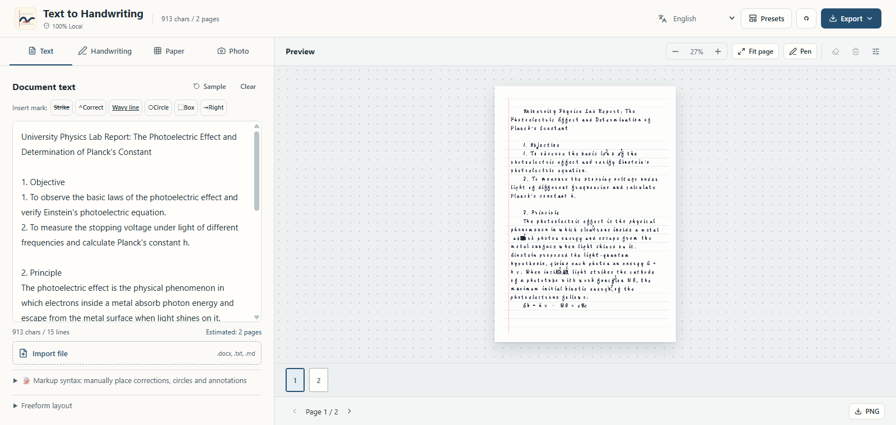

# مولد الكتابة اليدوية (Text2Handwriting)

> تحويل النصوص العادية إلى صفحات مكتوبة بخط اليد بواقعية عالية، يعمل محلياً بالكامل في متصفحك دون رفع أي بيانات إلى الخادم.

[简体中文](../../README.md) · [English](../../README.en.md) · [繁體中文](README.zh-Hant.md) · [日本語](README.ja.md) · [한국어](README.ko.md) · [Español](README.es.md) · [Français](README.fr.md) · [Deutsch](README.de.md) · [Português](README.pt.md) · [Русский](README.ru.md) · [Italiano](README.it.md) · **العربية** · [हिन्दी](README.hi.md) · [বাংলা](README.bn.md) · [ไทย](README.th.md) · [Türkçe](README.tr.md) · [Tiếng Việt](README.vi.md) · [Bahasa Indonesia](README.id.md)

[](../../LICENSE) [](https://github.com/rockbenben/365opensource)

[▶ التجربة عبر الإنترنت](https://shouxie.newzone.top)



مصمم خصيصاً للواجبات المدرسية المكتوبة بخط اليد، وملخصات القراءة، ومحاضر الاجتماعات، والرسائل الرسمية. على عكس الأدوات التقليدية التي تكتفي بتغيير الخط ميكانيكياً، يطبق Text2Handwriting تشويشاً عشوائياً مضبوطاً ببذرة عشوائية (Seed) على حجم الحروف، وزوايا الميل، وتذبذب خط الأساس، وكثافة الحبر لمحاكاة الواقعية. يعمل بالكامل داخل متصفحك دون الحاجة لتسجيل حساب أو إرسال بيانات إلى خوادم خارجية.

## مصفوفة التوافق

| البعد | التفاصيل |
|---|---|
| بيئة التشغيل | متصفحات سطح المكتب والهواتف الحديثة، يعمل 100% من جهة العميل؛ على الشاشات الضيقة يتحول تلقائياً إلى مساحة عمل بعمود واحد للتحرير والمعاينة مع أزرار مقسّمة أعلى الصفحة للتبديل (يدعم Chrome / Edge 103+ استعراض الخطوط المحلية، ويستخدم Safari / Firefox كشفاً داخلياً) |
| صيغ الاستيراد | لصق النص مباشرة، رفع ملفات `.txt` / `.md` (فحص صارم لترميز UTF-8 مع دعم احتياطي لـ GB18030)، أو ملفات `.docx` (استخراج محلي) |
| أنماط الورق | 6 قوالب جاهزة (دفتر مسطر، مربعات، ورقة A4 بيضاء، أربعة أسطر لكتابة الإنجليزية، ورق كرافت، شبكة نقطية) وإمكانية رفع صور مخصصة للورق مع ملاءمة تلقائية |
| الأقلام والمؤثرات | 4 فيزياء كتابة واقعية (حبر جاف، حبر سائل، رصاص، قلم كروي)؛ إضاءة محيطية منتشرة، ظلال الطيات، تلاشي الأطراف وتأثير تقادم الورق |
| خيارات التصدير | تصدير الصفحة الحالية بصيغة PNG / JPG، جميع الصفحات في أرشيف ZIP، ملف PDF متعدد الصفحات، وطباعة دقيقة بالميليمتر عبر إطار iframe خفي (حتى ~435 DPI) |
| التنضيد الطباعي | واجهة كاملة بـ 18 لغة؛ معالجة ذكية لنهايات الأسطر، علامات الترقيم، ودعم كامل للغة العربية والاتجاه من اليمين إلى اليسار (BiDi RTL) مع اتصال الحروف الطبيعي |
| العمل دون إنترنت | تطبيق ويب تقدمي PWA قابل للتثبيت؛ حماية من تعارض التعديلات عبر Web Locks بين التبويبات، وحفظ تلقائي كل 250 ميلي ثانية مع تنبيه قبل الإغلاق |

## المميزات الرئيسية

- **كتابة يدوية واقعية**: تشويش شبه عشوائي مضبوط بالبذرة العشوائية يتحكم في حجم الحروف والتباعد والميل والانحراف وتعب اليد أثناء الكتابة. كل إخراج فريد تماماً، والاحتفاظ بالبذرة يضمن إعادة إنتاج نفس النتيجة بدقة 100%.
- **تنضيد ذكي ودعم الاتجاهين**: دعم كامل لـ 18 لغة؛ قواعد ضبط علامات الترقيم وبدايات ونهايات الأسطر، إزاحة بداية الفقرة، وترقيم الصفحات ومحاذاة التوقيع جهة اليمين؛ دعم أصيل للخط العربي المتصل مع حماية الأقواس وعلامات الترقيم المزدوجة.
- **خامات الورق والصور**: تحكم كامل بتباعد الأسطر وهوامش الصفحة؛ شبكة مربعات متناسقة؛ ملاءمة تلقائية للصور المرفوعة مع مقاس A4؛ ظلال طيات طبيعية وإضاءة واقعية.
- **أي خط تريده**: 8 خطوط يدوية مفتوحة المصدر (4 مدمجة تعمل دون اتصال + 4 يتم تحميلها من Google Fonts). استيراد خطوط النظام، خطوط Google Fonts، أو سحب ملفات `.ttf` / `.otf` / `.woff` / `.woff2` (متوافق مع Calligraphr لتحويل خط يدك إلى خط حاسوبي).
- **تصحيحات وشطب واقعي**: 13 نمط شطب (خط مفرد، مزدوج، متموج، خربشة) بنسب احتمالية قابلة للتعديل؛ شطب الأخطاء وكتابة التصحيح فوق السطر؛ يدعم شريط أدوات اللوحة رسم الأسهم والمخططات والدوائر يدوياً، مع ممحاة ومسح رسومات الصفحة الحالية وخطوط إرشاد للهوامش.
- **أنماط كتابة جاهزة**: 4 أنماط بضغطة زر واحدة (طالب متفوق حريص، تدوين ملاحظات عفوي، كتابة متسرعة، واجب مدرسي نموذجي) لتطبيق شدة التشويش وملمس الكتابة واحتمالية الشطب فوراً.

## بنية الوسوم

استخدم وسوم التنسيق المضمنة مباشرة داخل النص للتحكم الدقيق في عمليات الشطب والتمييز:

| الوسم | التأثير البصري |
|---|---|
| `~~خطأ~~` أو `[del]خطأ[/del]` | شطب النص |
| `[del:تصحيح]خطأ[/del]` | شطب الكلمة وكتابة التصحيح فوق السطر |
| `[u]تمييز[/u]` | خط سفلي متموج |
| `[circle]تمييز[/circle]` | إحاطة النص بدائرة (اسم بديل `[圈]…[/圈]`) |
| `[box]تمييز[/box]` | إحاطة النص بإطار مربع (اسم بديل `[框]…[/框]`) |
| `[right]التوقيع[/right]` | محاذاة السطر بالكامل إلى اليمين (اسم بديل `[靠右]…[/靠右]`) للتوقيعات والتواريخ |

## البدء السريع

1. افتح [النسخة التجريبية](https://shouxie.newzone.top) أو استورد ملف نصي (`.txt` / `.docx` / `.md`).
2. اختر نوع الورق، والخط اليدوي، ونمط الكتابة من اللوحة الجانبية اليسرى، واضبط شدة التشويش أو إضاءة الصورة الفعلية حسب الحاجة (على الهاتف استخدم أزرار «التحرير / المعاينة» المقسّمة أعلى الصفحة للتبديل بين العمودين).
3. اضغط على "تصدير" في الشريط العلوي لتنزيل صور عالية الدقة (PNG / JPG)، أو أرشيف ZIP لجميع الصفحات، أو ملف PDF متعدد الصفحات، أو الطباعة مباشرة بالحجم الحقيقي بالمليمتر.

## القيود المعروفة

- يعتمد تنضيد النصوص اللاتينية والشرق آسيوية على تقدير عرض الحروف لضمان سرعة معالجة المستندات الكبيرة (يستخدم النص العربي قياسات Canvas الأصلية)؛ مع بعض الخطوط اليدوية الخاصة قد تحدث اختلافات طفيفة في نهايات الأسطر.
- ميزة الطباعة في المتصفح تطبع الصفحة الحالية فقط؛ لطباعة المستند كاملاً استخدم تصدير PDF.
- في متصفح Safari بإصداراته الأقدم من 16، يؤدي غياب دعم `ctx.filter` إلى تعطيل ضبط سطوع وتباين صورة الخلفية.
- ترتبط طبقة الرسم اليدوي بأرقام الصفحات في الذاكرة؛ قد تؤدي التعديلات الكبيرة على النص التي تغير عدد الصفحات إلى إزاحة الرسومات.
- من الخطوط المدمجة 4 خطوط متاحة دون اتصال ضمن الحزمة؛ أما الخطوط الأربعة الأخرى (Liu Jian Mao Cao وZCOOL XiaoWei وCaveat وKalam) فتُحمَّل من Google Fonts عند التشغيل، وتعود إلى خطوط النظام عند انقطاع الشبكة أو في الشبكات الداخلية.
- الخطوط المحلية المستوردة بصيغ `.ttf` / `.otf` / `.woff` / `.woff2` تُحفظ فقط في ذاكرة جلسة المتصفح الحالية وتتطلب إعادة اختيارها بعد تحديث الصفحة.

## التطوير المحلي

يتطلب بيئة Node.js **22.12+ / 24+ / 26+**:

```bash
npm install
npm run dev        # تشغيل خادم التطوير المحلي على http://localhost:5173/
npm test           # تشغيل اختبارات Vitest
npm run lint       # التحقق من جودة الكود البرمجي (oxlint)
npm run build      # بناء حزمة الإنتاج (tsc + vite)
```

تعتمد مخرجات البناء في مجلد `dist/` على مسارات نسبية (`base: './'`) ويمكن استضافتها على GitHub Pages أو أي خادم ويب. لمزيد من التفاصيل راجع [docs/development.md](../development.md).

## الترخيص

- **الكود البرمجي**: ترخيص MIT، راجع [LICENSE](../../LICENSE)
- **الخطوط**: الخطوط المدمجة في مجلد `public/fonts/` مرخصة بموجب ترخيص الخطوط المفتوحة SIL Open Font License (OFL)، راجع [LICENSE-FONTS.md](../../LICENSE-FONTS.md)

هذا المشروع تطبيق مستقل تماماً وليس له أي صلة بأي أدوات خارجية للكتابة اليدوية.

## عن خطة 365 مفتوح المصدر

المشروع **#039** من [خطة 365 مفتوح المصدر](https://github.com/rockbenben/365opensource) — شخص واحد + ذكاء اصطناعي، أكثر من 300 مشروع مفتوح المصدر في عام واحد.

[شارك فكرتك →](https://365.aishort.top/) · [Discord](https://discord.gg/PZTQfJ4GjX) · [Telegram](https://t.me/aishort_top)
