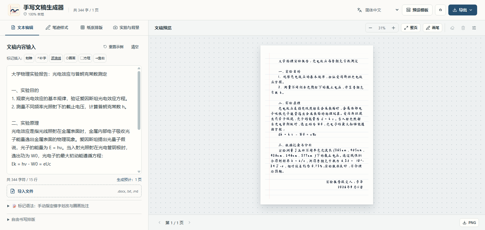

# 手寫文稿產生器 (Text2Handwriting)

> 把普通文字排成逼真手寫文稿，作業檢討筆記一鍵生成，全程本地不上傳。

[简体中文](../../README.md) · [English](../../README.en.md) · **繁體中文** · [日本語](README.ja.md) · [한국어](README.ko.md) · [Español](README.es.md) · [Français](README.fr.md) · [Deutsch](README.de.md) · [Português](README.pt.md) · [Русский](README.ru.md) · [Italiano](README.it.md) · [العربية](README.ar.md) · [हिन्दी](README.hi.md) · [বাংলা](README.bn.md) · [ไทย](README.th.md) · [Türkçe](README.tr.md) · [Tiếng Việt](README.vi.md) · [Bahasa Indonesia](README.id.md)

[](../../LICENSE) [](https://github.com/rockbenben/365opensource)

[▶ 線上試用](https://shouxie.newzone.top)



適合需要補交紙本作業、謄抄讀書筆記、準備手寫檢討或列印手寫信件的場景。不同於機械替換字型的普通工具，它基於隨機種子即時擾動每個字的字號、傾斜與基線，模擬真實墨跡深淺與塗改筆誤，無需註冊帳號或上傳雲端，在瀏覽器本地即可得到自然逼真的手寫文稿。

## 支援範圍

| 維度 | 說明 |
|---|---|
| 執行環境 | 現代桌面與行動瀏覽器純前端本地執行；窄螢幕自動切換為「編輯 / 預覽」單欄工作區，可用頂部分段按鈕切換（Chrome / Edge 103+ 支援列舉本機全部字型，Safari / Firefox 自動切換內建探測） |
| 匯入格式 | 直接貼上文字，或上傳 `.txt` / `.md`（嚴格 UTF-8 校驗與 GB18030 兜底）、`.docx`（用戶端免上傳解析） |
| 紙張底紋 | 6 種常用紙張（橫線本、作文方格、A4 白紙、英文四線三格、牛皮信箋、點陣手帳），支援上傳手機拍紙照片自適應縮入 |
| 筆型質感 | 原子筆、鋼筆、鉛筆、圓珠筆 4 種物理筆型；支援漫反射環境光、折痕明暗線、四角鏡頭暗角與歲月泛黃質感 |
| 匯出選項 | 當前頁 PNG / JPG、全部頁面 ZIP 打包、多頁 PDF、隱藏 iframe 真實毫米無損列印（三檔畫質最高約 435 DPI） |
| 語言排版 | 內建 18 種語言完整翻譯；支援中文避頭尾法則、英文斷詞保護、阿拉伯語雙向排版 (BiDi RTL) 與原生連筆整形 |
| 離線儲存 | PWA 離線外殼支援安裝到桌面與手機；Web Locks 跨分頁並發互斥保護，自動 250ms 防抖儲存與關閉前防誤關確認 |

## 能做什麼

- **手寫真實感**：種子控制的偽隨機擾動——字號浮動、字距微調、基線抖動、整行漂移、筆跡滲墨深淺與書寫疲勞效應，每版輸出都不同；記下種子可 100% 精確重現同一次排版。
- **智慧排版與雙向文本**：內建 18 種語言完整在地化；嚴格執行中文避頭尾規則、首行縮排、長文件自動分頁與落款右對齊；英文單字回溯防截斷；原生支援阿拉伯語等 RTL 文字整行連筆整形與括號標點保護。
- **紙張與實拍質感**：自由調節行距與頁邊距，作文格單元格自適應正方形連動；手機拍紙自動等比縮入 A4 邊框；配合漫反射光照、對折折痕、鏡頭暗角與復古泛黃，擺脫「一眼假」。
- **字型自由載入**：內建 8 款開源手寫字型（4 款隨包離線 + 4 款從 Google Fonts 線上載入），可載入系統已安裝字型、線上字型，或直接拖入 `.ttf` / `.otf` / `.woff` / `.woff2` 檔案（可配合 Calligraphr 製作個人專屬手寫字）。
- **擬真塗改與標註**：13 種劃改樣式（單線、雙線、波浪、密集塗抹等）按真實機率隨機出現，支援劃除錯字並在上方補寫正確字；畫布工具列支援畫筆手繪箭頭、草圖與圈選，並可切換橡皮擦、清空本頁手繪與頁邊參考線。
- **書寫人格預設**：工整學霸風、隨性筆記風、匆忙趕工風、規範作業風 4 種典型書寫風格，一鍵套用擾動強度、書寫質感與塗改機率。

## 標記語法

在正文中新增行內標記可手動指定劃改與圈選位置（標記優先於隨機機率）：

| 語法 | 渲染效果 |
|---|---|
| `~~錯字~~` 或 `[del]錯字[/del]` | 劃掉文字 |
| `[del:糾正]筆誤[/del]` | 劃掉文字並在行上方寫出正確字 |
| `[u]重點[/u]` | 重點波浪底線 |
| `[circle]重點[/circle]` | 筆跡圈出（中文別名 `[圈]…[/圈]`） |
| `[box]重點[/box]` | 筆跡框出（中文別名 `[框]…[/框]`） |
| `[right]落款[/right]` | 整行右對齊（中文別名 `[靠右]…[/靠右]`），適合落款與日期 |

## 快速開始

1. 開啟 [線上試用頁面](https://shouxie.newzone.top) 或匯入文字檔案（`.txt` / `.docx` / `.md`）。
2. 在左側面板挑選紙張樣式、手寫字型與書寫人格，按需微調擾動幅度或實拍光影（手機端用頂部「編輯 / 預覽」分段按鈕切換左右兩欄）。
3. 點擊頂欄「匯出」下載高畫質圖片（PNG / JPG）、全部頁面 ZIP、多頁 PDF，或直接使用真實尺寸毫米列印。

## 限制

- 中英文排版預設使用字號比例估算字寬，以保證百頁長篇秒級排版回應（阿拉伯雙向排版已啟用原生 Canvas 測量）；在特定與標準字寬偏差較大的書法體或使用者自製 .ttf 上，行尾可能略微超出或短於預期位置。
- 瀏覽器列印只列印當前頁；如需列印全書文稿請選擇匯出 PDF 後列印。
- Safari 16 以下不支援 `ctx.filter`，底圖的亮度與對比度微調在老舊 Safari 上失效。
- 手繪圖層按頁碼綁定且僅在記憶體中暫存；大幅修改正文導致文件重排分頁後，原有手繪圖層可能出現跨頁錯位。
- 內建字型中 4 款隨包可離線使用；另外 4 款（劉建毛草體、站酷小薇體、Caveat、Kalam）執行時從 Google Fonts 載入，斷網或內網環境會回退到系統字型。
- 本地匯入的 `.ttf` / `.otf` / `.woff` / `.woff2` 字型僅保留在當前分頁記憶體中，重新整理頁面後需重新選擇匯入。

## 本地開發

需要 Node.js **22.12+ / 24+ / 26+**（CI 使用 Node 26 建置）：

```bash
npm install
npm run dev        # 啟動本地開發伺服器 http://localhost:5173/
npm test           # 執行單元測試套件 (Vitest)
npm run lint       # 靜態程式碼檢查 (oxlint)
npm run build      # 生產環境打包 (tsc + vite)
```

建置產物 `dist/` 採用相對路徑（`base: './'`），可直接部署於 GitHub Pages 或企業內部網路伺服器。分包策略、架構設計與新增語言指南見 [開發文件 (docs/development.md)](../development.md)。

## 授權條款

- **程式碼**：MIT License，詳見 [LICENSE](../../LICENSE)
- **字型**：`public/fonts/` 內建字型遵循 SIL Open Font License (OFL)，授權詳情見 [LICENSE-FONTS.md](../../LICENSE-FONTS.md)

本專案為獨立實現，與第三方同類工具無任何關聯。

## 關於 365 開源計畫

[365 開源計畫](https://github.com/rockbenben/365opensource) 的第 **#039** 個專案——一人 + AI，一年 300+ 個開源專案。

[提交你的點子 →](https://365.aishort.top/) · [Discord](https://discord.gg/PZTQfJ4GjX) · [Telegram](https://t.me/aishort_top)
